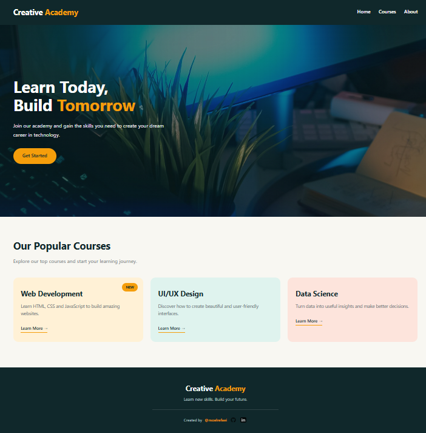
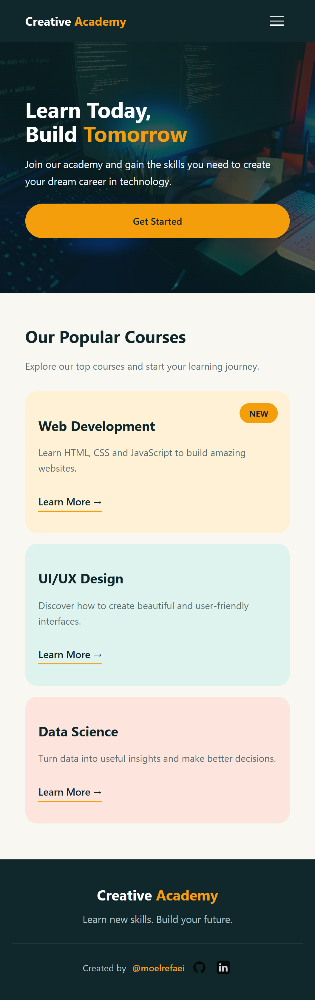

# nextgen-frontend-internship-task2
Creative Academy is A fully responsive, modern web interface crafted with semantic HTML and custom CSS.

## 📸 Screenshots

### Desktop View

### Mobile View

## 🛠️ Built With
* **HTML5:** Semantic elements for structure and accessibility.
* **CSS3:** Custom styling, variables, Flexbox, and CSS Grid layouts.
* **Responsive Design:** Media queries ensuring breakpoints from mobile up to desktop.

## 📐 Layout & Breakpoints
* **Mobile (Default):** Single-column stacked layouts, touch-friendly navigation, and fluid typography.
* **Tablet / Desktop:** Multi-column grid structures and expanded layouts triggered via CSS media queries.

## ✒️ Author
* Developed for the Creative Academy Project portfolio by moelrefaei.
